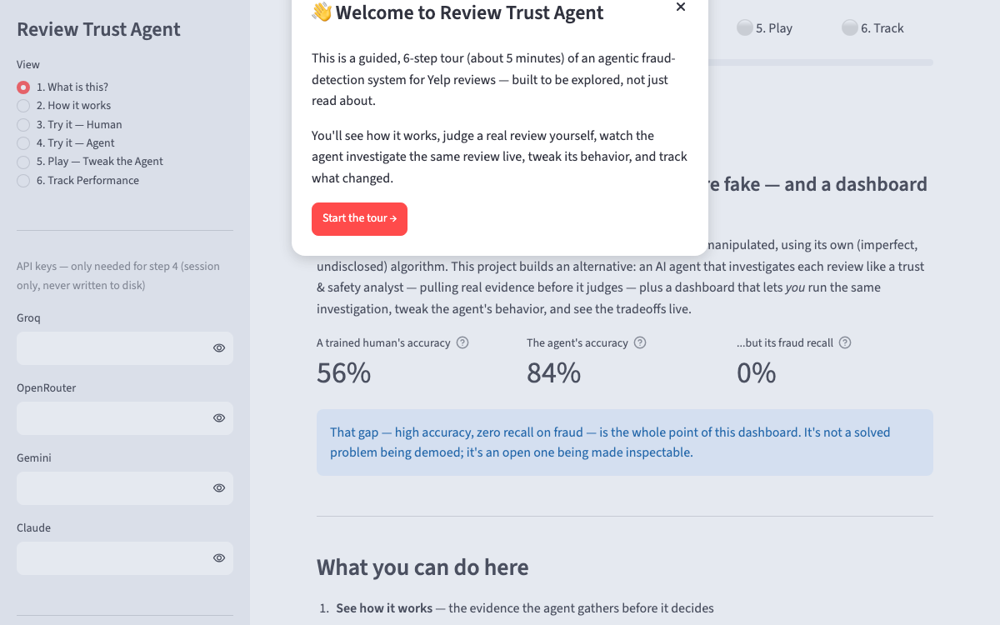

# Review Trust Agent

An AI agent that investigates whether a Yelp review is fake — and a live dashboard
that lets you second-guess it, tweak its behavior, and see the tradeoffs.



**[Try the live dashboard →](https://review-trust-agent.streamlit.app/)**

**Original dashboard agent:** in a 50-review evaluation batch, it scored 84% accuracy
but **0% recall** on the six Yelp-filtered examples. On this class-imbalanced task, a trivial
"always guess genuine" baseline scores 88% — *higher* than the careful, evidence-weighing
agent, while doing zero actual work. This is the original dashboard result, not the later
Jev experiment.

**Best Jev result:** the decomposed Jev workflow reached **7.8% recall** (31/397) and
83.2% accuracy on a separate locked 3,000-review holdout, versus 4.8% recall and 84.2%
accuracy for Jev v1. The recall improved, but it missed the 85% accuracy target and was
not compared directly with the active dashboard agent. Jev remains experimental; see the
[full results and limitations](experiments/jev-recall-experiment-report.md).

**[Read the full case study →](PRODUCT_CASE_STUDY.md)** — business problem, impact,
hypothesis, users & JTBD, scope & tradeoffs, evaluation plan, top risks, plus three real
hard-case walkthroughs.

**[Read the architecture & modularization guide →](ARCHITECTURE.md)** — current system
boundaries, shared contracts, experiment plug-in points, and the safe migration plan.

**[Review the Jev recall experiment plan →](experiments/jev-recall-experiment.md)** —
design, evaluation safeguards, key handling, and run log.
**[Read the Jev experiment report →](experiments/jev-recall-experiment-report.md)** —
3,000-review final results, prompt and development tuning, limitations, and next steps.

This dashboard is a real Streamlit app running real Python — not a mockup. Every
number, chart, and control is wired to a real computation (see "What's real vs. scoped
down" below).

## Try it

- **Human Review** and **System Config** and **Performance Tracking** work
  immediately, no API key needed.
- **Agent Review** (the live agent) needs your own API key for one provider —
  paste it in the sidebar (session-only, never stored). Get a free key in
  under a minute: [Groq console](https://console.groq.com/keys) (the default
  configured provider) or [OpenRouter](https://openrouter.ai/keys).

## What's real vs. scoped down for this public demo

- **Real:** every tool call (reviewer history, business trend, text
  similarity), every LLM call, every judgment, every config deploy — all
  running against genuine Yelp review data (the
  [YelpZip](https://odds.cs.stonybrook.edu/yelpzip-dataset/) research
  dataset).
- **Scoped down:** the full dataset is 608K reviews (~400MB) — too large for
  a public GitHub repo. This demo ships a trimmed index: every review in the
  5,000-review evaluation sample, plus each of those reviewers'/businesses'
  most recent real history (up to 40 other reviews per reviewer, 60 per
  business). It's genuine data throughout, just capped in volume rather than
  full-dataset scale — see `scripts/data_index.py`.
- **Not persistent:** this runs on Streamlit Community Cloud's free tier,
  which has an ephemeral filesystem. New judgments you log and new config
  versions you deploy will reset if the app restarts (goes to sleep after
  inactivity, or redeploys). The seeded historical baselines (56% human
  accuracy, 84% original agent accuracy from the original project) always reload on
  restart since they come from the checked-in CSVs.

## Run it locally instead

```bash
pip install -r requirements.txt
streamlit run dashboard/app.py
```
